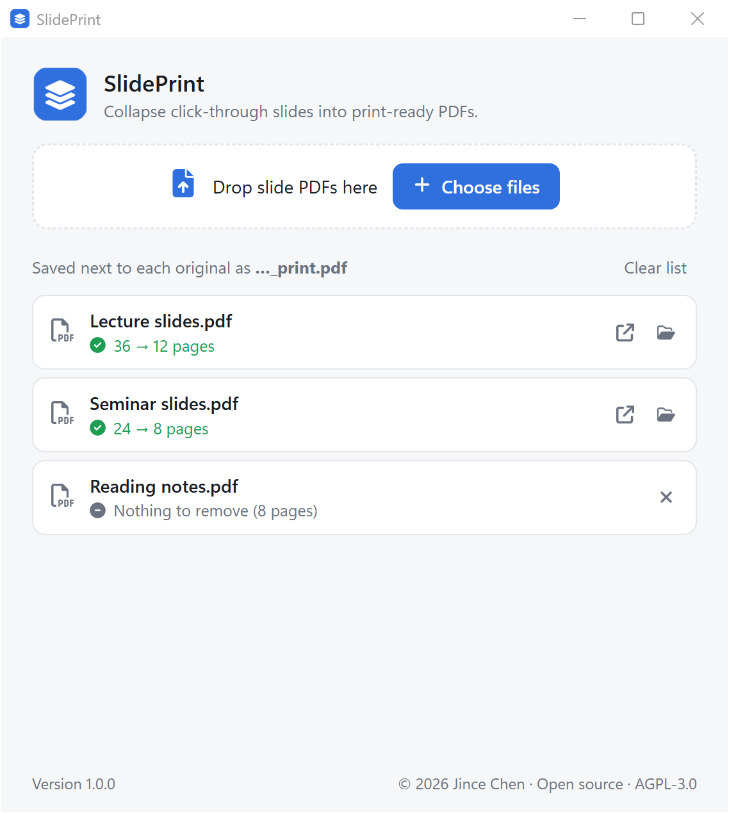

# SlidePrint

Slide PDFs often contain a separate page for every animation step. If you have the original LaTeX or PowerPoint file, you can simply export a clean version. But what if all you have is the PDF?

SlidePrint removes intermediate build-up pages and keeps only the complete version of each slide, making the PDF easier to print and read. Your original file is never changed.



## Using it

1. Download SlidePrint from the [latest release](https://github.com/jincechen/slide-print/releases/latest):
   - **Windows 10 or 11:** `...windows-x86_64.exe`. No installation is needed.
   - **macOS 11 or later:** `...macos-arm64.dmg` for Macs with Apple silicon (M1 or later), or `...macos-x86_64.dmg` for Intel Macs. Open the `.dmg` and drag SlidePrint into Applications.
2. Open it and click **Choose files** to select one or more PDFs, or drop them into the window. Processing starts automatically.
3. Each result is saved next to the original: `talk.pdf` -> `talk_print.pdf`.

You can also drop folders into SlidePrint, or drop PDFs directly onto the app (the `.exe` on Windows, or the Dock/Finder icon on macOS). On macOS, you can also use Open With → SlidePrint.

Since SlidePrint is not yet code-signed or notarized, you may see a warning when launching it for the first time:

- **Windows:** If you see *“Windows protected your PC”*, click **More info → Run anyway**.
- **macOS:** If you see *“Apple could not verify SlidePrint is free of malware”*, go to **System Settings → Privacy & Security → Open Anyway**. Allow file access when prompted.

If something goes wrong, click **Copy details** next to the file and include that text when you [open an issue](https://github.com/jincechen/slide-print/issues).

## How it works

SlidePrint removes a page only when everything visible on it also appears on the next page. If a click replaces or removes content instead of simply adding to it, both pages are kept.

The original PDF pages are copied directly, so:

- text stays selectable;
- images stay just as sharp;
- bookmarks and links keep working;
- page content is not re-rendered or recompressed.

It works well with PDFs exported from Beamer, PowerPoint, Keynote, and similar slide software.

Password-protected PDFs need to be unlocked first.

## Running from source

To run the app from source, install Python 3.12 and open a terminal in the project folder. Use `python` on Windows or `python3` on macOS for the commands below.

Install the dependencies:

```sh
python -m pip install -r requirements.txt
```

Run the app:

```sh
python -m slideprint
```

The core PDF processor can also be used directly:

```sh
python -m slideprint.dedup talk.pdf
```

Choose a different output name, or preview which pages would be kept without writing a PDF:

```sh
python -m slideprint.dedup talk.pdf -o out.pdf
python -m slideprint.dedup talk.pdf --dry-run
```

To run the tests: `python tests/test_dedup.py`.

The project is laid out as follows:

```text
slideprint/           the program
  dedup.py            finds build-up pages and writes the print version
  gui.py              Python side of the app (Windows and macOS)
  ui.html             app interface
tests/                basic tests
packaging/
  windows/            builds SlidePrint.exe
  macos/              builds SlidePrint.app
icons/                app icons, and the script that draws them
.github/workflows/    tests, builds, and publishes releases
```

## Building

### Windows

With Python 3.12 on your PATH, run:

```powershell
.\packaging\windows\build.bat
```

This produces:

```text
dist\SlidePrint.exe
```

### macOS

With Python 3.12 on your PATH as `python3.12` (from [python.org](https://www.python.org/downloads/macos/) or Homebrew), run:

```sh
./packaging/macos/build.sh
```

This produces the app and a disk image to share it with, both for the Mac's own processor (Apple silicon or Intel):

```text
dist/SlidePrint.app
dist/SlidePrint.dmg
```

The GitHub Actions workflow also builds the apps automatically (Windows, macOS Apple silicon, and macOS Intel) and publishes a release when you push a version tag such as `v1.0.0`, with the notes from `CHANGELOG.md`.

## Licence

© 2026 Jince Chen

SlidePrint is free software under the GNU Affero General Public License v3.0 or later. See [`LICENSE`](LICENSE) for details.

It uses [PyMuPDF](https://github.com/pymupdf/PyMuPDF) and [pywebview](https://github.com/r0x0r/pywebview), and on macOS [PyObjC](https://github.com/ronaldoussoren/pyobjc). Third-party licences are listed in [`THIRD_PARTY_NOTICES.txt`](THIRD_PARTY_NOTICES.txt).
